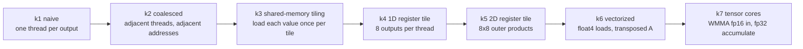

# gemm-ladder: from a naive CUDA GEMM to tensor cores, one idea at a time

Seven CUDA C++ matrix-multiply kernels, each changing exactly **one** idea, every rung checked against
cuBLAS and timed against it. The point is not the final number. It is being able to say *why* each step is
faster, with the arithmetic to back it up. (Inspired by the "build it up from scratch" style of
`micrograd`/`nanoGPT`/`llm.c`, and by Simon Boehm's CUDA matmul worklog.)



## Run it (Colab T4, about 5 minutes)

```bash
git clone https://github.com/ekambaranath/gemm-ladder && cd gemm-ladder
make check                       # builds, checks all 7 rungs vs cuBLAS at 512^3
make run                         # M=N=K=4096, writes results/gemm_ladder.csv
python scripts/plot_ladder.py    # writes docs/gemm_ladder.png
```

Other GPUs: `make ARCH=sm_80` (A100), `sm_89` (L4/RTX 40), `sm_90` (H100). No GPU? `make emu` runs every kernel
on the CPU with real threads and barriers and compares to a double-precision reference. It verifies indexing and
synchronization only, and says nothing about speed. I confirmed it is a real test: deliberately breaking two
kernels (a transposed index in k3, a wrong component in k6) makes it fail both.

## What each rung does, and why it should help

Notation: `C[M,N] = A[M,K] x B[K,N]`, `2*M*N*K` flops (137 GFLOP at M=N=K=4096). Without reuse every FMA needs two
4-byte loads, so the whole game is raising the number of FMAs per byte moved at each level of the memory hierarchy
(global, shared, registers).

**k1 naive.** One thread per C element, loop over K. Threads in a warp differ in the *row* index, so the 32
lanes read `A[x*K+k]` 4096 floats apart and write `C[x*N+y]` 4096 floats apart: each lane's access is its own
memory transaction. Memory-system efficiency is the problem, not arithmetic.

**k2 coalesced.** Same math, remap threads so the 32 lanes of a warp own 32 consecutive *columns* of one row.
`B[k*N+col]` and `C[row*N+col]` are now contiguous (one transaction per warp) and `A[row*K+k]` is a broadcast.
Only an index change; the memory-access pattern is what moves.

**k3 shared-memory tiling.** A block owns a 32x32 tile of C and walks K in steps of 32. Each step loads one
32x32 tile of A and B into shared memory, then does 32 FMAs per thread out of shared memory. Each global value is
now fetched once per tile instead of once per use, so global traffic drops by about 32x.

**k4 1D register tiling.** Each thread computes 8 outputs of one column. For each k it loads one B value into a
register and reuses it 8 times. Per k step that is 9 shared-memory loads (1 B + 8 A) for 8 FMAs, about 0.9 FMA
per load, versus 0.5 in k3 (2 loads per FMA). Fewer loads per flop means the FMA units wait less.

**k5 2D register tiling.** Each thread owns an 8x8 patch (64 accumulators). Per k it loads 8 A values and 8 B
values and does an 8x8 outer product: 64 FMAs for 16 shared loads, 4 FMAs per load, up from 0.5 in k3. This is
the structure real SGEMM kernels use.

**k6 vectorized.** `float4` (128-bit) global loads and stores, plus storing A *transposed* in shared memory so
the inner loop reads 8 consecutive A values instead of striding by BK. Fewer, wider memory instructions and a
cleaner shared-memory access pattern.

**k7 tensor cores (WMMA).** fp16 inputs, fp32 accumulation, 16x16x16 matrix-multiply-accumulate per warp
instruction. 8 warps per block, each owning a 64x32 patch (4x2 fragments). Shared tiles are padded by 8 halves
so rows land in different banks and every fragment pointer stays 32-byte aligned (a WMMA requirement). This rung
changes *precision*, so it is compared with cuBLAS running on tensor cores, not with fp32 SGEMM.

## Correctness first

Every rung runs against cuBLAS before it is timed. Output is pre-filled with a NaN pattern so an unwritten
element fails the check. Inputs are rounded to fp16 first so fp32 and tensor-core rungs see identical values.
A rung that fails is reported FAIL and its timing is not to be trusted. Tolerance: relative Frobenius error
`< 1e-4` for fp32 rungs, `< 2e-3` for the fp16 tensor-core rung.

## Results

> **Not measured yet.** Run `make run` on a GPU and paste `results/gemm_ladder.csv` / `docs/gemm_ladder.png`
> here. Numbers in this table must come from your own run.

| kernel | ms | TFLOP/s | % of matching cuBLAS | rel err |
|---|---|---|---|---|
| _fill from your run_ | | | | |

Things to check once you have numbers, each a hypothesis the data can confirm or refute:

1. k1 -> k2 should be a large jump from an index change alone (memory coalescing).
2. k2 -> k3 should help (data reuse) and k3 -> k5 should help more (register reuse).
3. k6 may or may not beat k5. If it does not, find out why (registers, occupancy, bank conflicts) with Nsight.
4. k7 should be several times k6 in absolute TFLOP/s, but may sit well below cuBLAS tensor cores, which use
   software pipelining (`cp.async`), swizzled layouts and tuned tile shapes that this kernel does not.

For each rung, profile with `make ncu K=k5_regtile2d` (Nsight Compute; not preinstalled on Colab) and record
achieved occupancy, shared-memory bank conflicts, and the stall reason. That, not the speedup, is what turns this
into evidence.

## Known limits (deliberate)

- Sizes must be multiples of 128 (K a multiple of 32). No edge-tile handling, to keep each kernel readable.
- Tile shapes are fixed, not autotuned; cuBLAS selects per-shape.
- k7 uses WMMA, not raw `mma.sync` / `cp.async` pipelines, so it is not expected to match cuBLAS tensor-core speed.
- Single square shape only; skinny shapes (LLM decode) behave very differently and are the next step.

## Next steps

- Raw `mma.sync` with `cp.async` double buffering and an XOR-swizzled shared layout.
- Skinny-M int8/int4 weight GEMM for LLM decode (the follow-up to the Triton kernel in `inferlab-pytorch`).
- Warp-tile level tuning and a small autotuner.

## Layout

```
src/kernels.cuh       the seven kernels, heavily commented
src/main.cu           harness: correctness vs cuBLAS, CUDA-event timing, CSV output
tests/emu_shim.h      CPU emulation of the CUDA execution model (threads, barriers, shared memory, WMMA)
tests/emu_test.cpp    runs every kernel on the CPU against a double-precision reference
scripts/plot_ladder.py  bar chart of the ladder
Makefile              build / check / run / ncu / emu
```
