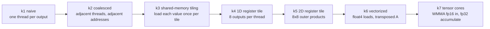

# gemm-ladder: from a naive CUDA GEMM to tensor cores, one idea at a time

Seven CUDA C++ matrix-multiply kernels, each changing exactly **one** idea, every rung checked against
cuBLAS and timed against it. The point is not the final number. It is being able to say *why* each step is
faster, with the arithmetic to back it up. (Inspired by the "build it up from scratch" style of
`micrograd`/`nanoGPT`/`llm.c`, and by Simon Boehm's CUDA matmul worklog.)



## Run it (Colab T4, about 5 minutes)

```bash
git clone https://github.com/ekambaranath/gemm-ladder && cd gemm-ladder
make check                       # builds, checks all 7 rungs vs cuBLAS at 512^3
make run                         # M=N=K=4096, writes results/gemm_ladder.csv (git-ignored)
python scripts/plot_ladder.py results/gemm_ladder.csv docs/gemm_ladder.png
```

Other GPUs: `make ARCH=sm_80` (A100), `sm_89` (L4/RTX 40), `sm_90` (H100). No GPU? `make emu` runs every kernel
on the CPU with real threads and barriers and compares to a double-precision reference. It verifies indexing and
synchronization only, and says nothing about speed. I confirmed it is a real test: deliberately breaking two
kernels (a transposed index in k3, a wrong component in k6) makes it fail both.

## What each rung does, and why it should help

Notation: `C[M,N] = A[M,K] x B[K,N]`, `2*M*N*K` flops (137 GFLOP at M=N=K=4096). Without reuse every FMA needs two
4-byte loads, so the whole game is raising the number of FMAs per byte moved at each level of the memory hierarchy
(global, shared, registers).

**k1 naive.** One thread per C element, loop over K. Threads in a warp differ in the *row* index, so the 32
lanes read `A[x*K+k]` 4096 floats apart and write `C[x*N+y]` 4096 floats apart: each lane's access is its own
memory transaction. Memory-system efficiency is the problem, not arithmetic.

**k2 coalesced.** Same math, remap threads so the 32 lanes of a warp own 32 consecutive *columns* of one row.
`B[k*N+col]` and `C[row*N+col]` are now contiguous (one transaction per warp) and `A[row*K+k]` is a broadcast.
Only an index change; the memory-access pattern is what moves.

**k3 shared-memory tiling.** A block owns a 32x32 tile of C and walks K in steps of 32. Each step loads one
32x32 tile of A and B into shared memory, then does 32 FMAs per thread out of shared memory. Each global value is
now fetched once per tile instead of once per use, so global traffic drops by about 32x.

**k4 1D register tiling.** Each thread computes 8 outputs of one column. For each k it loads one B value into a
register and reuses it 8 times. Per k step that is 9 shared-memory loads (1 B + 8 A) for 8 FMAs, about 0.9 FMA
per load, versus 0.5 in k3 (2 loads per FMA). Fewer loads per flop means the FMA units wait less.

**k5 2D register tiling.** Each thread owns an 8x8 patch (64 accumulators). Per k it loads 8 A values and 8 B
values and does an 8x8 outer product: 64 FMAs for 16 shared loads, 4 FMAs per load, up from 0.5 in k3. This is
the structure real SGEMM kernels use.

**k6 vectorized.** `float4` (128-bit) global loads and stores, plus storing A *transposed* in shared memory so
the inner loop reads 8 consecutive A values instead of striding by BK. Fewer, wider memory instructions and a
cleaner shared-memory access pattern.

**k7 tensor cores (WMMA).** fp16 inputs, fp32 accumulation, 16x16x16 matrix-multiply-accumulate per warp
instruction. 8 warps per block, each owning a 64x32 patch (4x2 fragments). Shared tiles are padded by 8 halves
so rows land in different banks and every fragment pointer stays 32-byte aligned (a WMMA requirement). This rung
changes *precision*, so it is compared with cuBLAS running on tensor cores, not with fp32 SGEMM.

## Correctness first

Every rung is checked before it is timed, two ways:

1. **Against cuBLAS** (relative Frobenius error over the whole matrix).
2. **Against an independent fp64 reference** computed on the host: 128 sampled output elements recomputed in
   double precision from the same fp16-rounded inputs. This does not trust cuBLAS, so it catches the case where a
   kernel and cuBLAS agree with each other but are both wrong.

Output is pre-filled with a NaN pattern, so an unwritten element fails. A rung that fails either check is reported
FAIL and its timing is not to be trusted. Tolerance: `< 1e-4` for fp32 rungs, `< 2e-3` for the fp16 tensor-core rung.

**Measured outcome (T4, 4096^3, worst scaled error over the 128 samples, `|got - ref| / (|ref| + 1)`):**
cuBLAS fp32 and all six fp32 rungs k1 to k6 show the same 2.18e-05, and match cuBLAS bit for bit (relative error
exactly 0). That is expected, not suspicious: each of these kernels accumulates every output sequentially over k with
fused multiply-add, and a non-split-K cuBLAS SGEMM does the same, so the rounding sequence is identical. The fp64
check shows that this shared result is the correct one up to ordinary fp32 accumulation error over K=4096. The
tensor-core rung accumulates differently and shows 1.37e-04 against fp64 (and 6.7e-6 against cuBLAS fp32 on the
full-matrix Frobenius metric; the two metrics are not directly comparable), well inside its 2e-3 tolerance.
The fp32 tolerance of 1e-4 is only about 5x above the observed error, and fp32 accumulation error grows with K,
so it would need loosening for much larger K.

## Results

Tesla T4 (Colab, sm_75, 40 SMs), M=N=K=4096, CUDA events, median of 10 timed runs per launch after warm-up. The
whole benchmark was run **three times**; the table gives the median over those three runs and the observed range.
Raw data: `results/gemm_ladder_median.csv` (table and chart) and `results/gemm_ladder_run3.csv` (one full run
including the fp64 column). Both were transcribed from console output.


| kernel | ms (median) | TFLOP/s (range over 3 runs) | % of matching cuBLAS (range) | step speedup | err vs fp64 |
|---|---|---|---|---|---|
| cuBLAS fp32 (reference) | 29.62 | 4.64 (4.49 to 4.64) | 100 | | 2.18e-05 |
| cuBLAS fp16 tensor cores | 3.36 | 40.87 (37.96 to 41.69) | 100 | | |
| k1 naive | 2220.7 | 0.06 | 1.3 (1.3 to 1.4) | | 2.18e-05 |
| k2 coalesced | 233.9 | 0.59 (0.58 to 0.59) | 12.7 (12.7 to 12.9) | 9.5x | 2.18e-05 |
| k3 shared-memory tiling | 146.9 | 0.94 (0.92 to 0.94) | 20.2 (20.2 to 20.4) | 1.59x | 2.18e-05 |
| k4 1D register tile | 69.7 | 1.97 (1.94 to 1.98) | 42.5 (42.5 to 43.1) | 2.11x | 2.18e-05 |
| k5 2D register tile | 39.5 | 3.48 (3.39 to 3.48) | 75.0 (75.0 to 75.5) | 1.76x | 2.18e-05 |
| k6 vectorized | 35.4 | 3.88 (3.78 to 3.91) | 83.6 (83.6 to 84.2) | 1.11x | 2.18e-05 |
| k7 WMMA tensor cores (fp16) | 6.57 | 20.92 (20.37 to 21.30) | 51.2 (48.9 to 55.1), of tensor-core cuBLAS | 5.4x vs k6 | 1.37e-04 |

k1 to k6 is a 63x speedup. k7 is a separate comparison because it changes precision.
Step speedups are ratios of the median times.

### What the data shows

- **Memory access pattern dominates first.** k1 to k2 is 9.5x from an index remapping alone, with identical
  arithmetic.
- **Reuse is the next lever, with diminishing returns.** Shared-memory tiling gave 1.59x, register tiling 2.11x then
  1.76x. FMAs per shared-memory load rise from 0.5 (k3) to about 0.9 (k4) to 4 (k5), but k3 to k5 is a 3.7x speedup,
  not 8x, so something else caps the gain.
- **Vectorization is a small win here (11%).** k6 changes two things at once (float4 loads and a transposed A tile),
  so the data cannot say which one helped; that needs an ablation.
- **The fp32 results are stable.** Each fp32 rung's percent-of-cuBLAS varied by at most 0.6 points across three runs.
- **At 512^3 the ladder flattens at the top** (one earlier run): k5 and k4 take the same time (0.278 ms vs
  0.281 ms). With 128x128 tiles a 512x512 output is only 16 blocks for 40 SMs, so the GPU cannot be filled. The grid
  arithmetic is fact; that it is the cause is my inference, not something I profiled.
- **Tensor cores: big absolute gain, about half of cuBLAS.** k7 is 5.4x faster than the best fp32 rung and reaches
  49 to 55% of cuBLAS tensor-core GEMM (about 32% of the T4's 65 TFLOP/s fp16 spec at the median).

### What it does not show (yet)

- **Why k7 stops at about half of cuBLAS.** Likely missing pieces: `cp.async` software pipelining, an XOR-swizzled
  shared layout instead of padding, and per-shape tuned tile sizes. These are hypotheses until profiled.
- **Why cuBLAS tensor-core throughput moved 38 to 42 TFLOP/s between runs** while k7 moved 20.4 to 21.3. The k7
  percentage range (49 to 55%) comes mostly from the cuBLAS baseline. Power or thermal clock changes are a plausible
  cause but the clock was not measured.
- **Percent of hardware peak.** The harness prints a spec-sheet fp32 peak (8.14 TFLOP/s at the 1590 MHz boost
  clock). T4s are power-capped and typically run below boost under sustained load, so percent-of-spec flatters the
  hardware; percent-of-cuBLAS is the more reliable number and is what the table uses.
- **Nsight Compute data.** No profile yet (occupancy, bank conflicts, stall reasons). That is the evidence that would
  turn these hypotheses into findings.

## Known limits (deliberate)

- Sizes must be multiples of 128 (K a multiple of 32). No edge-tile handling, to keep each kernel readable.
- Tile shapes are fixed, not autotuned; cuBLAS selects per-shape.
- k7 uses WMMA, not raw `mma.sync` / `cp.async` pipelines, so it is not expected to match cuBLAS tensor-core speed.
- Single square shape only; skinny shapes (LLM decode) behave very differently and are the next step.

## Next steps

- Raw `mma.sync` with `cp.async` double buffering and an XOR-swizzled shared layout.
- Skinny-M int8/int4 weight GEMM for LLM decode (the follow-up to the Triton kernel in `inferlab-pytorch`).
- Warp-tile level tuning and a small autotuner.

## Layout

```
src/kernels.cuh       the seven kernels, heavily commented
src/main.cu           harness: correctness vs cuBLAS, CUDA-event timing, CSV output
tests/emu_shim.h      CPU emulation of the CUDA execution model (threads, barriers, shared memory, WMMA)
tests/emu_test.cpp    runs every kernel on the CPU against a double-precision reference
scripts/plot_ladder.py  bar chart of the ladder
Makefile              build / check / run / ncu / emu
```
